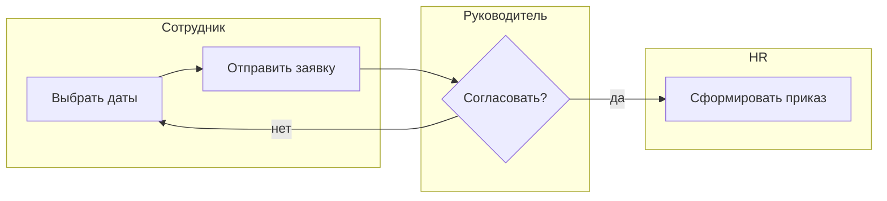
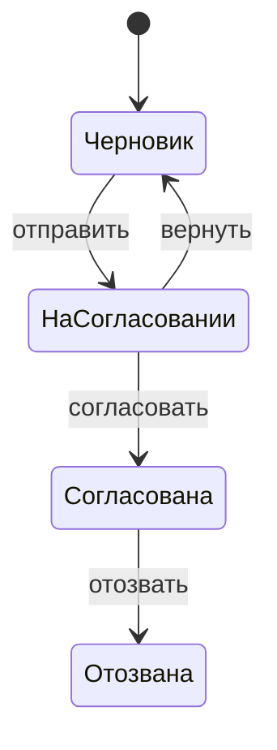

# Описание процессов

Цель – увидеть процесс таким, какой он есть на самом деле, найти потери и спроектировать целевой процесс, прежде чем автоматизировать.

## Шаги

### 1. Границы процесса

- Название в форме «глагол + объект»: «Согласовать отпуск».
- Триггер (что запускает) и результат (чем заканчивается, как понять, что завершён).
- Владелец процесса, участники, системы.
- Что не входит.

### 2. AS-IS – как есть на самом деле

Собирай по интервью с исполнителями каждого шага, а не только по регламенту. Регламент описывает, как должно быть; люди расскажут, как есть.

Для каждого шага:

| # | Шаг | Кто | Где (система/канал) | Вход | Выход | Время работы | Время ожидания | Частота ошибок/возвратов |
|---|---|---|---|---|---|---|---|---|

Отдельно опиши исключения: что если руководитель в отпуске, если данные неверны, если сотрудник передумал, если сроки нарушены. Обычно именно в исключениях живёт основная боль.

### 3. Найди потери

Отметь шаги:
- **ожидание** (заявка лежит у согласующего);
- **повторный ввод** одних и тех же данных;
- **возвраты** на исправление;
- **лишние согласования** без реального контроля;
- **переходы между системами и каналами** (портал → почта → бумага);
- **ручные проверки**, которые можно сделать правилом.

Посчитай: доля времени ожидания от общего времени цикла. Обычно она больше 80% – значит, ускорять надо очереди, а не работу.

### 4. TO-BE – как должно быть

Сначала **без автоматизации**: какие шаги убрать, объединить, переставить, делегировать. Затем – что автоматизировать. Для каждого изменения – какую потерю убирает и какой эффект.

### 5. Нотации (выбери нужное)

**Плавательные дорожки (mermaid):**


**Жизненный цикл объекта** – для заявок, документов, запросов. Опиши все состояния и переходы; затем заполни матрицу «состояние × событие» без пустых ячеек (пустая ячейка = непродуманный случай).



**Таблица решений** – для правил с несколькими условиями:

| Тип отпуска | Стаж < 6 мес | Остаток ≥ запроса | Результат |
|---|---|---|---|
| Ежегодный | да | – | Нужно согласование HR |
| Ежегодный | нет | да | Согласует руководитель |
| Ежегодный | нет | нет | Отказ: недостаточно дней |

Проверь, что все комбинации покрыты, иначе добавь строку «иначе».

**RACI** – кто исполняет (R), отвечает (A, ровно один), консультирует (C), информируется (I) – для каждого шага.

### 6. Проверь

- Каждый шаг имеет исполнителя и результат.
- У каждого решения (ромба) есть все выходы.
- Описаны исключения и откаты.
- Ни у одного шага нет двух ответственных (A).
- Процесс заканчивается однозначным результатом.

## Формат результата

```markdown
# Процесс: <название>
## Границы
## AS-IS (схема + таблица шагов)
## Исключения
## Потери и их цена
## TO-BE (схема), что изменили и почему
## Правила (таблицы решений)
## Жизненный цикл объекта
## RACI
## Эффект изменений
## Открытые вопросы
```

## Источники

- Lean: виды потерь, доля ожидания во времени цикла; BPMN 2.0 (OMG) в упрощённом виде.
- Матрица «состояние × событие» без пустых ячеек и полнота таблиц решений – по мотивам осей вычитки [deminded/masterspec](https://github.com/deminded/masterspec).
- Идея `state-machine` – [Owl-Listener/designer-skills](https://github.com/Owl-Listener/designer-skills) (MIT).
