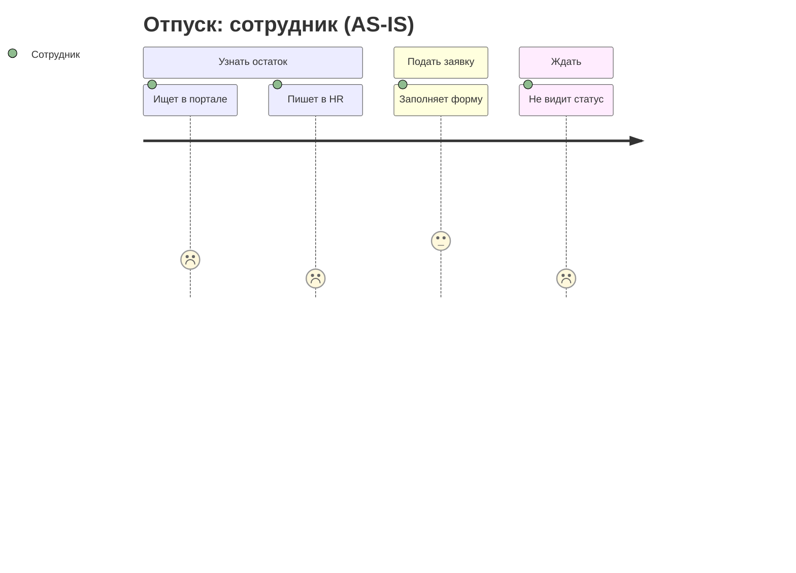

# CJM / путь сотрудника

Цель – карта одного человека в одном сценарии от начала до конца, построенная на данных, с понятными точками для улучшения.

## Вход

Интервью, синтез, JTBD, данные из систем и поддержки. Карта «из головы» допустима как черновик – пометь её как гипотетическую и запланируй проверку.

## Шаги

### 1. Рамки

- **Кто** – одна персона или сегмент (руководитель с командой 10+ человек ≠ сотрудник производства).
- **Сценарий** – конкретная работа из JTBD («спланировать и оформить отпуск»).
- **Начало и конец** – с какого события начинается путь и чем заканчивается. Не обрезай: путь часто начинается до сервиса (узнал о правиле от коллеги) и заканчивается после (получил отпускные).
- **Вид:** как есть (AS-IS) или как должно быть (TO-BE). Начинай с AS-IS.

### 2. Этапы

5–8 этапов в терминах пользователя, не системы: «Узнать, сколько дней» → «Договориться с командой» → «Подать заявку» → «Дождаться согласования» → «Получить документы и деньги» → «Вернуться».

Для внутренних сервисов типовые сквозные пути: найм и выход на работу (onboarding), первые 90 дней, обучение и развитие, оценка эффективности, отпуск и отсутствие, справки и документы, перевод и повышение, увольнение (offboarding). Каждый – отдельная карта.

### 3. Строки карты

| Строка | Что писать |
|---|---|
| Цель на этапе | Что человек хочет получить |
| Действия | Что делает (глаголы) |
| Точки контакта | Системы, люди, документы, каналы (портал, почта, мессенджер, звонок в HR, бумага) |
| Мысли и вопросы | Цитаты из интервью |
| Эмоция | Шкала от −2 до +2 с обоснованием |
| Боли | Что мешает, с источником |
| Время | Сколько занимает работа и ожидание |
| За кадром | Кто и что делает невидимо для пользователя (связь с `service-blueprint`) |
| Возможности | Идеи улучшения |
| Метрика этапа | Как измерить качество этапа |

### 4. Эмоциональная кривая и моменты истины

- Нарисуй кривую эмоций по этапам.
- **Моменты истины** – где формируется отношение к сервису (первое обращение, ожидание решения, ошибка).
- **Пик и конец** запоминаются сильнее всего: худший момент и последний этап важнее средних.

### 5. Возможности и приоритет

Для каждой возможности: какая боль закрывается, насколько массово, оценка эффекта и сложности. Топ-3–5 в работу (см. `prioritization`).

## Специфика внутренних сервисов

- **У пользователя нет выбора** – он не уйдёт к конкуренту, но уйдёт в обходные пути (почта, звонок, «попросить коллегу»), а нагрузка ляжет на HR и руководителей. Обходные пути – главный индикатор плохого опыта; включай их в карту.
- **Несколько ролей в одном пути** – сотрудник, руководитель, HR, бухгалтерия. Сделай дорожку для каждой или отдельные карты; часто боль сотрудника – следствие перегруза руководителя.
- **Контекст работы** – офис, производство без компьютера, удалёнка, разные часовые пояса, мобильный доступ.
- **Редкие события** – отпуск раз в год, справка раз в несколько лет: люди не помнят, как делать. Значит, нужна подсказка в моменте, а не обучение заранее.
- **Метрики:** время цикла, доля самообслуживания без обращений в HR, повторные обращения, eNPS/CES по этапу.

## Формат результата

- Таблица карты в markdown (этапы – столбцы, строки – как выше).
- Эмоциональная кривая (mermaid `xychart-beta` или описание).
- Список возможностей с приоритетом.
- Источники данных по каждой ячейке (код интервью или ссылка на данные).

## Анти-паттерны

- Карта всего опыта всех сотрудников сразу.
- Этапы = экраны системы.
- Эмоции без основания.
- Красивая карта, после которой ничего не меняется – всегда заканчивай списком возможностей с владельцами.

## Что дальше

`service-blueprint`, `prioritization`, `user-flows-ia`, `prototyping`.

## Источники

- Джим Калбах, «Mapping Experiences»; NN/g о картах пути; правило «пик-конец» (Канеман).
- Структура строк – по мотивам `journey-map` из [Owl-Listener/designer-skills](https://github.com/Owl-Listener/designer-skills) (MIT) и `customer-journey-map` из [deanpeters/Product-Manager-Skills](https://github.com/deanpeters/Product-Manager-Skills) (идеи).
