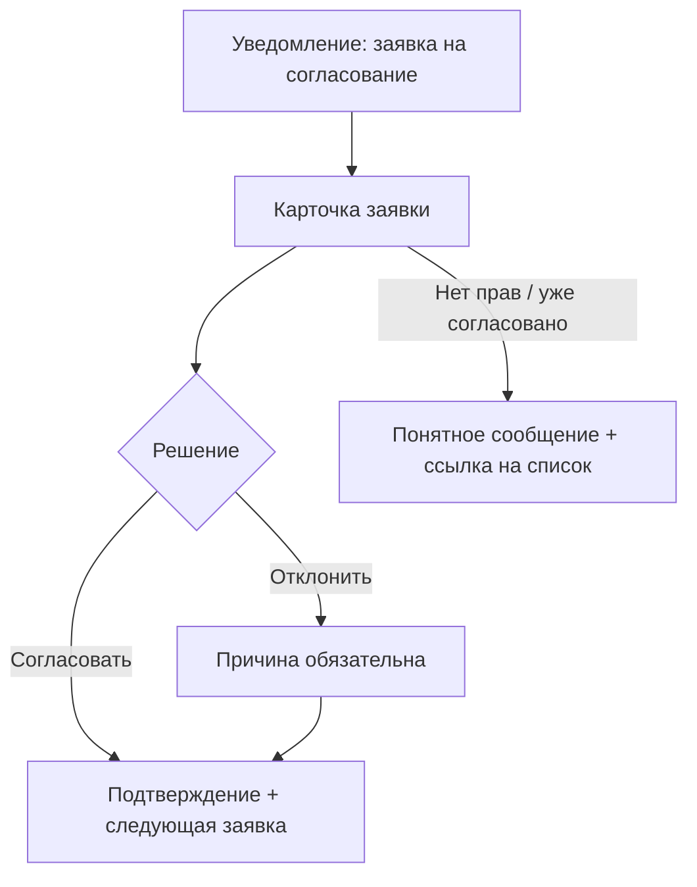

# Пользовательские флоу и информационная архитектура

Цель – определить, из каких экранов и состояний состоит решение и как человек находит нужное, до рисования интерфейса.

## Часть 1. Информационная архитектура

### Шаги

1. **Инвентаризация** – список всего содержимого и функций (сервисы, документы, справочники, новости, заявки).
2. **Группировка глазами пользователя** – по задачам и жизненным ситуациям, а не по оргструктуре компании. «Отпуск и отсутствия», а не «Отдел кадрового администрирования».
3. **Проверка группировки** – открытая карточная сортировка (пользователи группируют сами) для поиска модели; закрытая или tree-test (пользователи ищут в готовом дереве) для проверки. Цель для tree-test – больше 70–80% успешных находок по ключевым задачам.
4. **Названия** – слова пользователей из интервью, а не внутренний жаргон. Одно понятие – одно название везде.
5. **Глубина** – ключевые задачи на расстоянии не более 2–3 переходов от главной.
6. **Поиск** – для портала со многими сервисами поиск часто главный вход. Синонимы («отпуск», «отгул», «отсутствие»), опечатки, раскладка, поиск по сервисам и по документам.

### Результат

```markdown
## Карта разделов
- Главная
  - Мои задачи (входящие согласования)
  - Отпуска и отсутствия
    - Остаток и график
    - Новая заявка
## Глоссарий названий
## Результаты проверки (если была)
```

## Часть 2. Пользовательский флоу

### Шаги

1. Возьми одну задачу из JTBD или историю.
2. Определи точку входа (откуда приходит: главная, уведомление, ссылка в письме, поиск) и точку выхода (как понимает, что закончил).
3. Опиши шаги: экран → действие → решение системы → следующий экран.
4. Добавь все ветки: ошибки ввода, нет прав, нет данных, внешняя система недоступна, пользователь передумал, вернулся позже, сессия истекла.
5. Для каждого экрана перечисли состояния: пустое (данных ещё нет), загрузка, частично, ошибка, успех.



### Проверки

- Нет тупиков: из каждого экрана есть понятный следующий шаг.
- Каждое решение системы имеет все выходы.
- Минимум шагов для частого сценария; редкие варианты не загромождают основной путь.
- Пользователь всегда знает, где он и что дальше.

## Анти-паттерны

- Навигация по оргструктуре.
- Флоу только «счастливого пути».
- Названия разделов, понятные только авторам.

## Что дальше

`prototyping`, `ux-writing`.

## Источники

- Луис Розенфельд, Питер Морвиль, «Information Architecture»; Донна Спенсер, «Card Sorting».
- Идеи `user-flow-diagram`, `card-sort-analysis`, `navigation-patterns`, `search-ux` – [Owl-Listener/designer-skills](https://github.com/Owl-Listener/designer-skills) (MIT).
